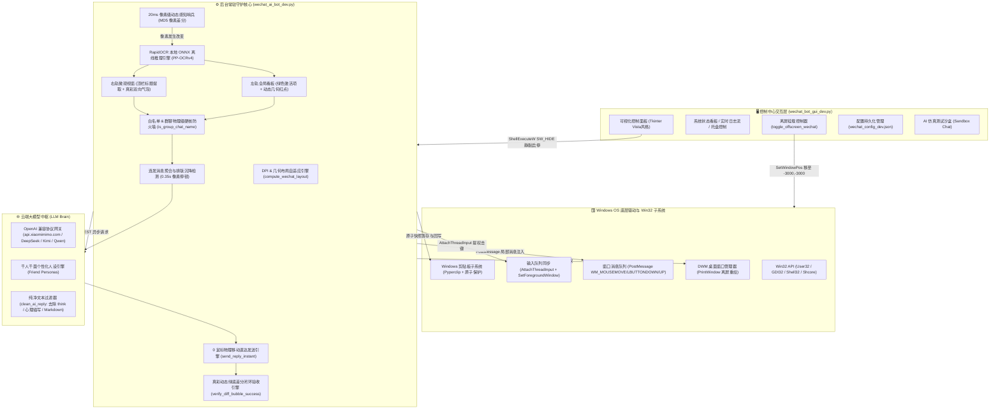
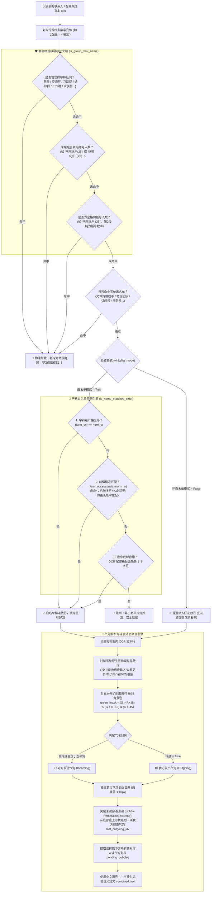
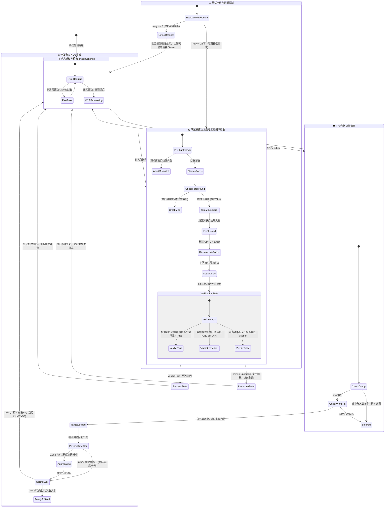

# 🤖 微信 AI 自动回复（开发版 · Zero-Mouse & Off-Screen）全系统架构与详细业务流程图

> **项目路径**：`d:\Antigravity对话保存位置\微信AI回复_开发版`  
> **核心定位**：100% 物理鼠标 0 移动 · 虚拟离屏隐形挂载 · 毫秒级视觉双轨感知 · 白名单物理级防火墙

---

## 📑 流程图导航目录
1. [系统整体架构与组件拓扑图（Overall Architecture）](#1-系统整体架构与组件拓扑图)
2. [GUI 控制中心与离屏挂载生命周期流程图（GUI & Off-Screen Lifecycle）](#2-gui-控制中心与离屏挂载生命周期流程图)
3. [后台守护核心：双轨协同感知主轮询流程图（Dual-Track Sensing Core）](#3-后台守护核心双轨协同感知主轮询流程图)
4. [安全门禁、群聊硬核防火墙与连发气泡聚合流程图（Firewall & Aggregation）](#4-安全门禁群聊硬核防火墙与连发气泡聚合流程图)
5. [Win32 穿透提权与 0 鼠标移动消息直达发送流程图（Zero-Mouse Injection）](#5-win32-穿透提权与-0-鼠标移动消息直达发送流程图)
6. [三态闭环验收与重试熔断状态机（Three-State Verification & State Machine）](#6-三态闭环验收与重试熔断状态机)

---

## 1. 系统整体架构与组件拓扑图



---

## 2. GUI 控制中心与离屏挂载生命周期流程图

```mermaid
flowchart TD
    Start(["用户启动控制中心 wechat_bot_gui_dev.py"]) --> InitUI["初始化界面、载入配置与启动后台监控线程"]
    InitUI --> CheckState{"定时轮询微信与守护进程状态 (1.0s)"}

    %% 状态检测分支
    CheckState -->|检查微信客户端 HWND| WxStatus["更新微信状态: 运行中 (版本 3.x/4.x Qt) / 未启动"]
    CheckState -->|检查 PID 文件与 psutil 进程池| BotStatus["更新守护状态: 运行中 (PID) / 已停止"]

    %% 用户交互触发
    WxStatus & BotStatus --> UserAction{"用户点击控制动作"}

    %% 启动服务
    UserAction -->|点击【🚀 启动 AI 自动回复】| CleanOld["执行 kill_wechat_bot_dev.py 清理残留旧进程"]
    CleanOld --> SaveCfg["自动持久化保存当前界面配置"]
    SaveCfg --> SilentStart["ShellExecuteW (SW_HIDE, 无控制台黑框) 启动后台核心"]
    SilentStart --> StartSuccess["提示守护进程已成功在后台静默运行"]

    %% 停止服务
    UserAction -->|点击【⏹️ 停止守护】| Terminate["调用 kill_bot_processes 精准终止后台核心 (保护 GUI)"]

    %% 离屏挂载控制
    UserAction -->|点击【👻 隐藏微信至离屏】| CheckOffScreen{"微信当前是否已处于负坐标离屏区 (-500 以外)？"}
    CheckOffScreen -->|否 (在桌面 / 最小化)| GetRect["获取微信真实尺寸 (GetWindowPlacement/GetWindowRect) 并保存"]
    GetRect --> MoveOffScreen["ShowWindow(SW_RESTORE) + SetWindowPos 移入 (-3000, -3000)"]
    MoveOffScreen --> UpdateBtnToRestore["按钮切换为【🖥️ 召唤微信回桌面】(桌面 0 弹窗干扰)"]

    CheckOffScreen -->|是 (已离屏)| ReadSavedRect["读取 saved_window_rect 历史坐标尺寸"]
    ReadSavedRect --> RestoreToDesktop["ShowWindow(SW_RESTORE) + SetWindowPos 移回原桌面位置"]
    RestoreToDesktop --> UpdateBtnToHide["按钮切换为【👻 隐藏微信至离屏】"]

    %% 日志流
    CheckState --> ReadLog["流式读取 wechat_bot_dev.log 增量更新至 ScrolledText"]
```

---

## 3. 后台守护核心：双轨协同感知主轮询流程图

```mermaid
flowchart TD
    StartDaemon(["后台守护核心启动 main_loop()"]) --> BindDesktop["确保桌面绑定 ensure_default_desktop() + DPI 感知设置"]
    BindDesktop --> LoopStart["进入心跳主循环 while True (默认轮询间隔 0.8s)"]

    LoopStart --> FindWx{"查找微信真实主窗口 get_wechat_hwnd()"}
    FindWx -->|未找到 / 仅有 Weixin 空壳| SleepNext["等待下个心跳周期"] --> LoopStart
    FindWx -->|获取到主窗口 HWND| GrabFrame["后台静默离屏抓图 grab_wechat_window(hwnd) (PrintWindow / DWM)"]

    GrabFrame --> Layout["计算物理动态布局 compute_wechat_layout(W, H)<br/>(自适应 100%~250% DPI 缩放与任意拉伸)"]
    Layout --> PixelGuard{"⚡ 像素级动态感知哨兵 (Pixel Sentinel)<br/>比对聊天区与侧边栏 MD5 哈希 + 红点粗筛"}

    PixelGuard -->|画面无变动 & 无红点 & 间隔<1s| FastBypass["⚡ 20ms 极速放行 (直接跳过 OCR，消除高 CPU 空转)"] --> SleepNext
    PixelGuard -->|检测到像素变动或存在红点| DownScale["动态等比下采样至宽度 1000px 加速 OCR 推理"]

    DownScale --> LocalOCR["RapidOCR 毫秒级本地神经网络推理 (det + rec)"]
    LocalOCR --> DualTrack["左右双轨协同感知分析"]

    subgraph DualTrackAnalysis["左右双轨协同感知分析"]
        TrackLeft["【左轨】侧边栏全局看板扫描:<br/>1. 提取高浓度绿色激活项 (已选中会话)<br/>2. 动态几何文字锚定未读红点 (has_red_badge_by_text_anchor)"]
        TrackRight["【右轨】主聊天视窗微观扫描:<br/>1. 提取顶栏好友标题 (extract_active_chat_title)<br/>2. 真彩气泡流向解析 (parse_chat_bubbles_chromatic)"]
    end

    DualTrack --> DualTrackAnalysis
    DualTrackAnalysis --> TargetGating{"目标识别与防火墙门禁判决"}

    %% 当前会话锁定通道
    TargetGating -->|当前聊天视窗命中有效目标| CheckUnread{"当前好友是否存在待回复新气泡？<br/>(以最后一条我方绿底为界回溯)"}
    CheckUnread -->|存在待回复新消息| SettlingCheck{"极速动态像素沉降判定 (0.35s 打字停顿)<br/>对方是否正在连发新气泡？"}
    
    SettlingCheck -->|气泡增加 (连发中)| DelayAgg["增量 OCR 聚合全部连发短句 (，拼接)"] --> GenReply
    SettlingCheck -->|像素平稳 (发送完毕)| GenReply["调用 LLM 脑神经生成回复 (generate_ai_reply)"]

    GenReply --> CheckReply{"AI 回复是否有效？"}
    CheckReply -->|有效| SendAction["执行极速秒回直达引擎 send_reply_instant()"]
    CheckReply -->|为空/超限/未配Key| SkipReg["记录告警并登记签名防空转"] --> LoopEnd

    SendAction --> SendSuccess{"发送是否成功？"}
    SendSuccess -->|成功 (绿底增量验收通过)| MarkDone["记录最后处理指纹签名 LAST_PROCESSED_SIGNATURE<br/>清除重试计数"] --> LoopEnd
    SendSuccess -->|失败/脱靶| HandleRetry["累加重试计数 (最多 2 次补偿重试，超限熔断)"] --> LoopEnd

    %% 跨好友切入通道
    CheckUnread -->|无待回复消息 (当前已彻底回完)| CheckOtherBadges{"左侧列表中是否存在其他白名单好友红点？"}
    CheckOtherBadges -->|存在红点 candidates| FilterCooldown{"检查防空转冷却时间 (> 3.0s？)"}
    FilterCooldown -->|通过| SwitchTarget["Win32 局部点击目标会话项中心 (post_click_client_point)<br/>0 鼠标移动切入新好友视窗"]
    SwitchTarget --> ResetHash["强制重置像素哨兵哈希，等待下个周期就地回复"] --> LoopEnd
    FilterCooldown -->|处于冷却中| LoopEnd
    CheckOtherBadges -->|无任何红点| LoopEnd

    TargetGating -->|非白名单/群聊阻断/无有效目标| CheckOtherBadges

    LoopEnd["周期结束，读取 check_interval_seconds 休眠"] --> LoopStart
```

---

## 4. 安全门禁、群聊硬核防火墙与连发气泡聚合流程图



---

## 5. Win32 穿透提权与 0 鼠标移动消息直达发送流程图

```mermaid
flowchart TD
    TriggerSend(["触发发送流程 send_reply_instant(target, final_reply)"]) --> PreFlight["🔍 发送前核验 (Pre-Flight Verification)<br/>重新抓取画面并 OCR 顶栏标题"]

    PreFlight --> CheckTarget{"顶栏标题是否为目标好友【target】？"}
    CheckTarget -->|否 (窗口偏离)| CorrectTarget["智能纠偏：在左侧列表中搜索 target 坐标<br/>局部 PostMessage 点击切入对应聊天"]
    CorrectTarget --> VerifyAgain{"列表中是否成功找到目标？"}
    VerifyAgain -->|否| AbortFuse["🚫 安全熔断：未在列表找到目标，坚决放弃发送以防串发！"]
    VerifyAgain -->|是| LockTarget["🎯 纠偏成功，切入目标视窗"]

    CheckTarget -->|是 (目标正确)| StartSendLoop["进入受控发送尝试循环 (最多 2 次 Attempt)"]
    LockTarget --> StartSendLoop

    subgraph AtomicStep["⚡ 0 物理鼠标移动原子执行链"]
        Step1["1. 剪贴板安全写入 safe_clipboard_copy(final_reply)<br/>(带 3 次冲突退避重试，化解 Win+V / 杀软占用)"]
        Step2["2. 发送前基线图像抓取 img_pre (留存差分基线)"]
        Step3["3. Win32 穿透提权 activate_wechat(hwnd):<br/>AttachThreadInput 同步输入队列 + SetWindowPos 突破 ASFW 焦点锁定"]
        Step4{"4. 击键前严格强校验：<br/>GetForegroundWindow() == hwnd？"}
        Step5["5. 动态自适应几何坐标模拟输入框聚焦 (0 鼠标移动):<br/>post_click_client_point 投递 WM_MOUSEMOVE + WM_LBUTTONDOWN/UP"]
        Step6{"6. 二次复验前台归属：<br/>GetForegroundWindow() == hwnd？"}
        Step7["7. 极速键盘事件注入 keybd_event:<br/>Ctrl+V (粘贴文本) + Enter (发送消息)"]
        Step8["8. 平稳切回用户原本窗口 SetForegroundWindow(user_orig_hwnd)<br/>(坚决废除 HWND_BOTTOM 压底，零视觉抢夺)"]
    end

    StartSendLoop --> Step1 --> Step2 --> Step3 --> Step4
    Step4 -->|否 (焦点被其他应用抢占)| BreakFocus["🚫 安全熔断终止击键，防止在其他应用误打字！"] --> NextAttempt
    Step4 -->|是| Step5 --> Step6
    Step6 -->|否 (光标脱失)| BreakFocus
    Step6 -->|是| Step7 --> Step8

    Step8 --> RenderWait["等待 0.35s 微信 Qt5 气泡动画与排版彻底沉降"]
    RenderWait --> GrabPost["抓取发送后画面 img_post"]
    GrabPost --> DiffVerify["执行严谨差分动态绿底增量闭环验收 verify_diff_bubble_success()"]

    DiffVerify --> DiffResult{"验收判决结果"}
    DiffResult -->|True (明确成功)| SendOK["✅ 绿底气泡显著增量确认，秒回成功！"]
    DiffResult -->|UNCERTAIN (抓图受阻/离屏黑屏)| SafeStop["⚠️ 画面无法比对，安全熔断终止重试 (按发出登记，杜绝复读)"]
    DiffResult -->|False (明确未见新气泡)| RetryAction["⚠️ 未检测到新气泡，执行下一次强力补偿重试"] --> NextAttempt{"尝试次数 < 2？"}

    NextAttempt -->|是| Step1
    NextAttempt -->|否| SendFail["❌ 发送脱靶告警，退出循环"]

    SendOK & SafeStop & SendFail --> RestoreClip["还原用户原始剪贴板文本内容"]
    RestoreClip --> EndSend(["结束本次发送流程"])
```

---

## 6. 三态闭环验收与重试熔断状态机



---

## 7. 核心架构关键特性技术指标表

| 核心模块 | 技术实现机制 | 解决的传统痛点 | 性能指标 |
| :--- | :--- | :--- | :--- |
| **0 物理鼠标移动** | `PostMessageW(WM_MOUSEMOVE, WM_LBUTTONDOWN, WM_LBUTTONUP)` | 传统按键精灵/PyAutoGUI 抢夺鼠标光标、拖拽乱跑 | 物理鼠标移动 **0 像素**，后台绝对静默 |
| **虚拟离屏隐形挂载** | `SetWindowPos` 负坐标离屏挂载 + `PrintWindow` GDI 离屏重绘 | 桌面弹窗打扰、微信被遮挡无法识别 | **0 弹窗**，即使被完全遮挡或离屏仍 100% 捕获 |
| **动态物理布局自适应** | 基于长宽比例的几何咬合引擎 (`compute_wechat_layout`) | 分辨率变化、DPI 缩放 (100%~250%) 导致坐标错位 | 任意窗口拖拽拉伸 **100% 几何锁定** |
| **像素动态哨兵感知** | 侧边栏与聊天区 20ms MD5 像素哈希差分 (`Pixel Sentinel`) | 无消息时 OCR 频繁死循环推理导致 CPU 满载发热 | 静态下直接 **20ms 极速放行**，OCR 功耗降低 90% |
| **群聊物理级防火墙** | 正则检测括号人数 `[\(（]\d+[\)）]` 与群关键词阻断 | 传统机器人误入群聊串发社死 | **100% 物理熔断**，绝不误发任何群聊 |
| **连发穿透聚合算法** | `0.35s` 人类打字停顿动态像素沉降 + 气泡回溯聚合 | 好友连发 3 句话触发 3 次回复，答非所问 | 自动聚合成完整长句，**单次精准应答** |
| **真彩差分闭环验收** | 发送前后 `RGB` 绿底气泡像素增量差分 (`verify_diff_bubble_success`) | 发送后盲目认为成功，实际发不出去或无休止重试 | **三态严谨仲裁** (`True`/`False`/`UNCERTAIN`) |
| **剪贴板原子保护** | 发送前快照保护 + 发送后自动还原原文本内容 | 自动化工具覆盖用户刚刚复制的密码/重要文件 | 瞬时切入还原，**用户操作零感知** |
