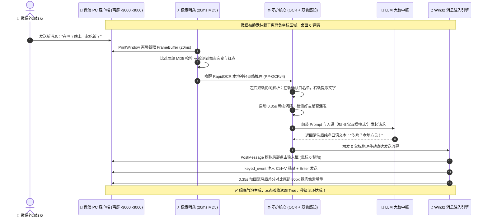
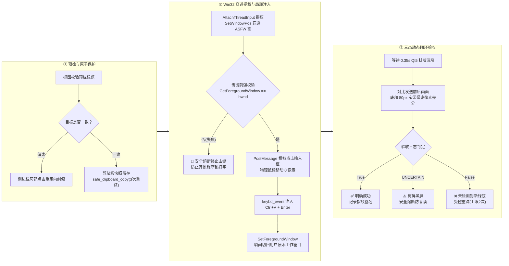

# 🖥️ 微信 AI 自动回复（开发版）核心原理流程图【16:9 宽屏横版】

> **项目路径**：[`D:\Antigravity对话保存位置\微信AI回复_开发版`](file:///D:/Antigravity%E5%AF%B9%E8%AF%9D%E4%BF%9D%E5%AD%98%E4%BD%8D%E7%BD%AE/%E5%BE%AE%E4%BF%A1AI%E5%9B%9E%E5%A4%8D_%E5%BC%80%E5%8F%91%E7%89%88)  
> **16:9 交互式全景看板**：[`D:\Antigravity对话保存位置\微信AI回复_开发版\流程图_16比9.html`](file:///D:/Antigravity%E5%AF%B9%E8%AF%9D%E4%BF%9D%E5%AD%98%E4%BD%8D%E7%BD%AE/%E5%BE%AE%E4%BF%A1AI%E5%9B%9E%E5%A4%8D_%E5%BC%80%E5%8F%91%E7%89%88/%E6%B5%81%E7%A8%8B%E5%9B%BE_16%E6%AF%949.html)  
> **设计规格**：16:9 横向延展拓扑 · 6 阶段流水线 · Win32 消息级穿透 · 0 物理鼠标移动 · 三态动态闭环

---

## 1. 核心业务流水线：16:9 横向贯通总流程图

```mermaid
flowchart LR
    subgraph S1["【阶段 1】离屏帧捕获"]
        direction TB
        A1["👻 虚拟离屏隐形挂载<br/>坐标 (-3000, -3000)"] --> A2["📸 DWM / PrintWindow<br/>底层显存重绘截取"]
        A2 --> A3["📐 动态几何咬合布局<br/>compute_wechat_layout"]
    end

    subgraph S2["【阶段 2】像素哨兵过滤"]
        direction TB
        B1["⚡ 20ms 动态像素哨兵<br/>MD5 局部哈希切片对比"] --> B2{"画面变动 / 发现红点？"}
        B2 -- 无变动 --> B3["⚡ 20ms 极速放行<br/>跳过 OCR 杜绝空转"]
        B2 -- 有变动 --> B4["🧠 RapidOCR 本地推理<br/>下采样至 1000px 提速"]
    end

    subgraph S3["【阶段 3】双轨协同感知"]
        direction TB
        C1["🟢 左轨全局看板<br/>识别绿色选中项与红点"] --> C2["🔍 右轨微观视窗<br/>提取顶栏标题与气泡"]
        C2 --> C3["🎨 真彩底色判别流向<br/>绿底我方 / 非绿对方"]
    end

    subgraph S4["【阶段 4】防火墙与聚合"]
        direction TB
        D1["🛡️ 群聊物理硬核阻断<br/>括号人数正则+群词"] --> D2["🎯 白名单越配防护<br/>防止'张三'串发'张三丰'"]
        D2 --> D3["⏳ 0.35s 动态沉降<br/>连发多句聚合为一条"]
    end

    subgraph S5["【阶段 5】大模型拟人生成"]
        direction TB
        E1["🎭 千人千面人设映射<br/>死党/恋人/商务/日常"] --> E2["🌐 OpenAI 兼容接口<br/>多轮上下文滑动窗口"]
        E2 --> E3["🧹 纯净文本清洗<br/>剔除 think / 心理描写"]
    end

    subgraph S6["【阶段 6】0 鼠标直达与验收"]
        direction TB
        F1["🖱️ 局部 PostMessage 点击<br/>物理鼠标 0 像素移动"] --> F2["⌨️ Win32 穿透提权击键<br/>Ctrl+V + Enter 极速发送"]
        F2 --> F3["✅ 三态动态绿底增量验收<br/>True / UNCERTAIN / False"]
    end

    S1 ==>|RGB 帧切片| S2
    B4 ==>|OCR 双轨数据| S3
    S3 ==>|过滤与提取目标| S4
    D3 ==>|合并后语义文本| S5
    E3 ==>|纯净口语回复| S6
```

---

## 2. 16:9 横向数据流时序与状态跃迁图

---

## 3. Win32 穿透提权与 0 鼠标物理直达微观流程图 (16:9 横向流)

---

## 4. 核心原理关键技术对照矩阵 (16:9 架构)

| 核心模块 | 底层原理机制 | 针对的传统缺陷 | 技术指标表现 |
| :--- | :--- | :--- | :--- |
| **👻 虚拟离屏隐形挂载** | `SetWindowPos(hwnd, 0, -3000, -3000)` + `PrintWindow` GDI 显存重绘 | 传统自动化必须置顶微信窗口，桌面弹窗频繁打扰 | **0 弹窗**，即使被完全遮挡或隐形依然 100% 捕获 |
| **⚡ 20ms 动态像素哨兵** | 侧边栏与聊天区切片 `MD5` 哈希比对 + 红像素掩膜快筛 | 传统 OCR 机器人 7x24 小时死循环推理，CPU 满载发热 | 静态下直接 **20ms 极速放行**，OCR 耗电降 90% |
| **🛡️ 物理硬核群聊防火墙** | 正则检测括号人数 `[\(（]\d+[\)）]$` 与群关键词字典 | 传统机器人误入微信群或服务号，产生串发重大社死 | **100% 物理拦截**，绝不漏防任何群聊 |
| **⏳ 连发动态像素沉降** | `0.35s` 人类打字停顿检测 + 底部向上回溯最后一条我方绿底 | 好友连续发送 3 条短句触发 3 次零散回复，语义混乱 | 自动合并为完整长句，**单次精准上下文回复** |
| **🖱️ 0 物理鼠标直达注入** | `PostMessageW(WM_MOUSEMOVE, WM_LBUTTONDOWN/UP)` | PyAutoGUI / 按键精灵移动真实光标，用户无法正常办公 | 物理鼠标移动 **0 像素**，后台绝对无痕打字 |
| **✅ 三态动态绿底闭环** | 发送前后 `RGB` 绿底增量差分（`post_bot - pre_bot >= 30`） | 盲发按键后以为成功，实际掉线漏回或死循环复读 | **三态严谨仲裁** (`True`/`UNCERTAIN`/`False`) |
| **🔒 剪贴板安全原子保护** | 发送前快照备份 + 写入冲突退避重试 + 发送后原子还原 | 脚本覆盖用户刚刚复制的重要文件或密码凭据 | 瞬态接管还原，**用户日常打字完全零感知** |
